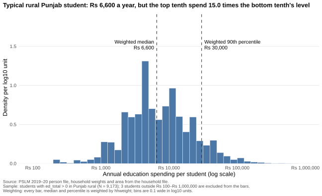
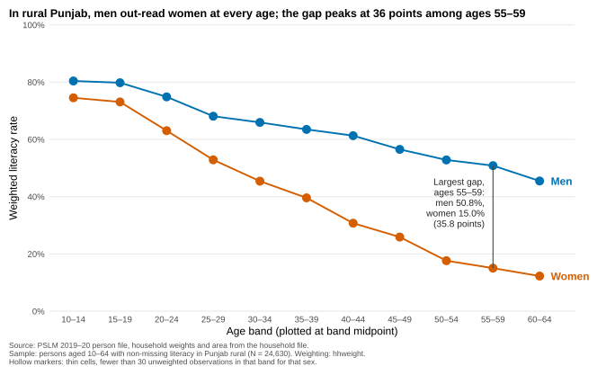
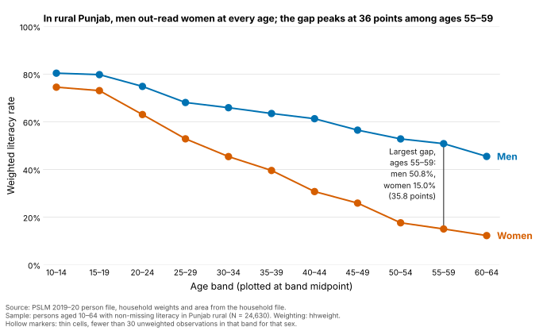

# ECO346 Assignment 1: education spending and literacy in rural Punjab

**Student:** FA24-BEDS-088 | **Section:** B | **Data:** PSLM 2019–20

## Variant

The last two digits of my registration number are 88, and 88 = 11 × 8 + 0, so my remainder is 0: **variant 0, Punjab rural** (`prov_code == 2`, `urban_rural == 1`).
`hhweight`, `prov_code` and `urban_rural` are attached to the person file from the household file by `hhid`; every statistic is weighted by `hhweight`.

| Sample | Definition | Persons |
|---|---|---:|
| Variant | Punjab rural | 35,925 |
| Literacy sample | aged 10–64, `literate` not missing | 24,630 |
| Students | `ed_total` > 0 | 9,173 |

## How to reproduce

From the repository root, with no internet needed (R packages: `readr`, `dplyr`, `tidyr`, `ggplot2`, `svglite`; Python packages: `pandas`, `numpy`, `matplotlib`):

```
Rscript scripts/01_default.R
Rscript scripts/02_distribution.R
Rscript scripts/03_literacy.R
python scripts/04_second_language.py
```

Run them in this order: script 04 checks its table against the one script 03 writes to `tables/`.

| Path | Contents |
|---|---|
| `data/` | the two PSLM CSV files |
| `scripts/` | `00_helpers.R` (shared definitions, weighted mean and quantile), then one script per figure, numbered in run order |
| `figures/` | `default.svg`, `distribution.svg`, `literacy_by_age.svg`, `literacy_by_age_python.svg` |
| `tables/` | numbers and band tables written by the scripts |
| `slides/` | `FA24-BEDS-088.pptx` |

## Question 2: the distribution



| Statistic | Value |
|---|---:|
| Students | 9,173 |
| Weighted median | Rs 6,600 |
| Unweighted median | Rs 7,000 |
| Weighted 10th percentile | Rs 2,000 |
| Weighted 90th percentile | Rs 30,000 |
| 90th ÷ 10th | 15.00 |
| Excluded (outside Rs 100–Rs 1,000,000) | 3 |

Rural Punjab students typically cost Rs 6,600 a year, but spending is very unequal: the 90th percentile (Rs 30,000) is 15 times the 10th (Rs 2,000), with a long right tail and spikes at round numbers. The medians differ slightly (Rs 6,600 weighted, Rs 7,000 unweighted) because the 50% mark sits at the heap at Rs 7,000; weighting lifts the share below Rs 7,000 from 49.8% to 50.7%, so the weighted median falls to Rs 6,600.

## Question 3: the relationship



| Age band | Women: persons | Women: literacy % | Men: persons | Men: literacy % |
|---|---:|---:|---:|---:|
| 10–14 | 2133 | 74.5 | 2209 | 80.4 |
| 15–19 | 1758 | 73.1 | 1922 | 79.8 |
| 20–24 | 1574 | 63.1 | 1449 | 74.9 |
| 25–29 | 1386 | 52.9 | 1201 | 68.1 |
| 30–34 | 1176 | 45.4 | 1037 | 65.9 |
| 35–39 | 1194 | 39.6 | 1006 | 63.5 |
| 40–44 | 903 | 30.7 | 843 | 61.3 |
| 45–49 | 776 | 25.9 | 737 | 56.5 |
| 50–54 | 657 | 17.6 | 708 | 52.8 |
| 55–59 | 535 | 15.0 | 517 | 50.8 |
| 60–64 | 412 | 12.3 | 497 | 45.5 |

No band has fewer than 30 observations for either sex (smallest: 412 women aged 60–64), so no marker is hollow.

| Weighted literacy rate | Women | Men |
|---|---:|---:|
| Ages 15–19 | 73.1% | 79.8% |
| Ages 55–59 | 15.0% | 50.8% |

Largest gap: **ages 55–59, 35.8 percentage points**.

Literacy falls with age for both sexes, but much faster for women: from 73.1% (women) and 79.8% (men) at ages 15–19 to 15.0% and 50.8% at 55–59. The gap widens from 6.7 to 35.8 points, consistent with older cohorts of rural girls having had far less access to schooling, a legacy of past underinvestment in women's human capital. The figure cannot tell us whether any individual lost literacy, or why: it is a single cross-section that mixes age and cohort.

## Question 4: the makeover

Default (`ggplot(data, aes(age, literate)) + geom_point()`, nothing else):


Redesign: the Question 3 figure above.

Three changes. (1) Conditional means: the default stacks 24,630 binary points in two rows, so overplotting hides any rate; I plot the weighted literacy rate per five-year band. (2) Perceptual ranking: rates are read by position on a common 0–100% scale, with lines joining bands and a colour-blind-safe pair, labelled directly with no legend. (3) Data–ink: I removed the grey panel and heavy grid, added a finding as the title and a caption with source, sample and weights, and weighted by hhweight. What the default shows and the redesign hides: single years of age and individual observations, so age heaping and the number of people at each age are invisible.

## Question 5: a second language (Python)

Script: `scripts/04_second_language.py`. It recomputes the band table from the raw CSVs, asserts that it agrees with the R table to one decimal, and redraws the figure as `figures/literacy_by_age_python.svg`.

| Women aged 15–19, weighted literacy rate | |
|---|---:|
| R | 73.1% |
| Python | 73.1% |

Axis limits and frame differed. ggplot's theme_minimal() gave a 0–100% axis, no box and light horizontal gridlines; matplotlib autoscaled the y-axis to the data, drew a four-sided box and no gridlines. I set ax.set_ylim(0, 100), hid all four spines, added y-axis gridlines, formatted ticks as percentages, and set fonts, colours and marker sizes by hand so the two figures match.


